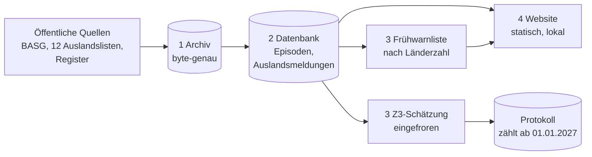
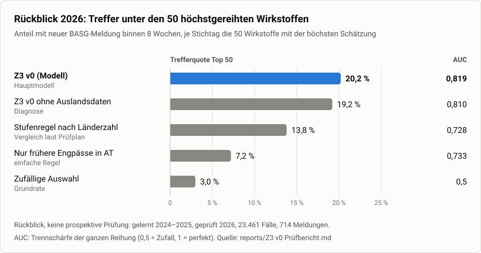
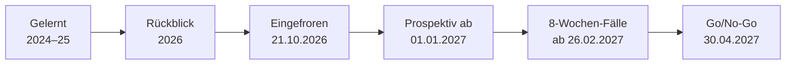

# Lieferengpass-Radar

[](https://doi.org/10.5281/zenodo.24168686)

**Ein Frühwarnwerkzeug für Arzneimittel-Lieferengpässe in Österreich: eine Python-Kommandozeile für Linux, die öffentliche Engpassregister täglich sichert und daraus Engpassverläufe, eine Frühwarnliste und eine statische Website erzeugt.**

Die Website ist für Apotheken, Spitalapotheken, Ärzt:innen und das öffentliche Gesundheitswesen gedacht; sie ist noch nicht online und wird lokal gebaut. Im Register des BASG (Bundesamt für Sicherheit im Gesundheitswesen) stehen täglich die Lieferengpässe, die Zulassungsinhaber für einzelne Arzneimittel-Packungen gemeldet haben, mit Status und angekündigtem Liefertermin. Das Register zeigt aber nur den heutigen Stand:

- Beendete Meldungen verschwinden. Ob und wie lange ein Präparat schon einmal knapp war, steht im Register nicht mehr.
- Wie oft ein angekündigter Liefertermin schon verschoben wurde, sieht man nicht.
- Ob derselbe Wirkstoff gerade in Italien oder Tschechien knapp ist, erfährt nur, wer ein Dutzend Behördenlisten in mehreren Sprachen liest.

**Was das Radar anders macht:**

- **Es vergisst nichts.** Täglich lädt es das BASG-Register und 12 Engpasslisten anderer Behörden (die EU-Arzneimittelagentur EMA und 11 Länder) und speichert sie unverändert, jede Fassung mit SHA-256-Prüfsumme, die jede Änderung erkennbar macht, und einem Eintrag im Audit-Trail.
- **Es verknüpft.** Aus dem Archiv entsteht je Packung (eine Packungsgröße, erkennbar an der PZN) der Verlauf jedes Engpasses. Eine Frühwarnliste nennt Wirkstoffe, die in Österreich lieferbar sind, aber in mindestens zwei anderen Ländern schon als knapp gemeldet.
- **Es schätzt nach vorab festgelegtem Prüfplan.** Ein Modell schätzt je Wirkstoff, wie wahrscheinlich binnen 8 Wochen eine neue BASG-Meldung kommt. Gelernt auf 2024–2025 und geprüft auf 2026 (23.461 Fälle, 714 neue Meldungen), reihte es Wirkstoffe besser als das bloße Zählen meldender Länder (AUC 0,819 gegen 0,728; 0,5 = Zufall, 1 = perfekt). Modell und Prüfplan wurden am 21.10.2026 eingefroren und liegen hier mit Prüfsummen vor; die prospektive Prüfung beginnt am 01.01.2027.

Das Projekt verwendet ausschließlich öffentliche Daten, keine Daten von Apotheken, Großhändlern oder Patient:innen.

[Schnellstart](#schnellstart) · [So funktioniert es](#so-funktioniert-es) · [Trägt die Schätzung?](#trägt-die-schätzung) · [Vorab-Registrierung](#vorab-registrierung) · [Neu](#neu-seit-v01-prereg) · [Dokumentation](documentation/README.md) · [English](README.md)

```bash
# Linux, Python ≥ 3.12, im geklonten Repository. Ein frischer Klon enthält keine Daten;
# Verläufe und Frühwarnungen entstehen erst aus täglichen Läufen aller Quellen.
python3 -m venv .venv && .venv/bin/pip install -e . && source .venv/bin/activate
stockout fetch --source basg      # nur das BASG-Register holen (rund 1,1 MB)
stockout build && stockout site   # Datenbank aus dem Archiv bauen, dann HTML-Seiten erzeugen
xdg-open site/index.html          # Beispiel vom 10.11.2026: „Lage am 10.11.2026“, 844 Packungen im Register,
                                  #   612 davon nicht oder eingeschränkt lieferbar, der Rest als „verfügbar“ markiert
```

## Beispiel: was die amtliche Liste nicht zeigt


*Erzeugt am 10.11.2026 von der Referenzinstanz: der Installation des Autors, die seit 17.10.2026 täglich läuft.*

Das BASG-Register führt für diese Packung heute einen Eintrag mit Status, Meldedatum und dem zuletzt angekündigten Termin. Das Radar zeigt, was davor geschah: gemeldet seit 15.09.2023, der Liefertermin neunmal verschoben, zuletzt auf den 31.10.2026, der am 10.11.2026 schon verstrichen war. Die Schraffur bedeutet „nicht täglich beobachtet“: Vor dem 17.10.2026 besteht das Archiv nur aus einzelnen Aufnahmen.

## So funktioniert es

Das Radar hat vier Teile, die nacheinander laufen: **sichern, verknüpfen, schätzen, zeigen.**



| Teil | Was er tut | Code (`src/stockout_at/`) · mehr dazu |
|---|---|---|
| Archiv (`stockout fetch`) | sichert jede neue Fassung unverändert, mit Prüfsumme und Protokollzeile; die Register löschen beendete Meldungen, ein Tag ohne Archiv ist verloren | `archive.py` · [DATENQUELLEN.md](documentation/DATENQUELLEN.md) |
| Datenbank (`stockout build`) | baut Engpass-Episoden je Packung (Beginn, Statusfolge, Terminverschiebungen, Ende) und verknüpft Auslandsmeldungen über den ATC-Code, den internationalen Code je Wirkstoff | `build.py`, `episodes.py`, `foreign.py` · [ARCHITEKTUR.md](documentation/ARCHITEKTUR.md) |
| Frühwarnung und Z3 | stuft Wirkstoffe nach der Zahl der Länder mit laufender Meldung (A: ab 5, B: 3–4, C: 2); das eingefrorene Modell Z3 schreibt täglich Wahrscheinlichkeiten in ein Protokoll | `fruehwarnung.py`, `modell.py`, `models/` · [MODELL_UND_BEWERTUNG.md](documentation/MODELL_UND_BEWERTUNG.md) |
| Website (`stockout site`) | statische Seiten: Lage am Stichtag, Verlauf je Packung, gleichwertige lieferbare Packungen, überfällige Termine, Frühwarnliste | `site.py`, `web/` · [WEBSITE.md](documentation/WEBSITE.md) |

Amtliche BASG-Felder stehen wörtlich da; Abgeleitetes trägt die Kennzeichnung „Eigene Auswertung“. Die Z3-Schätzung steht nur im Protokoll, nicht auf der Website.


*Frühwarnliste der Referenzinstanz, 10.11.2026, mit Quellen, die der öffentliche Code weglässt ([Unterschiede](#unterschiede-zur-referenzinstanz)). Die Seite sagt selbst: „Keine Prognose, keine Bestellempfehlung.“*

## Schnellstart

**Voraussetzungen:** Linux (geprüft auf Ubuntu mit Python 3.12.3), Python ≥ 3.12, Git und Internetzugang zum BASG. **Nicht nötig:** Konto, API-Schlüssel, Datenbankserver, Root-Rechte. `pdftotext` (poppler) braucht erst der volle Tagesbetrieb.

```bash
git clone https://github.com/benediktneumayer2-tech/lieferengpass-radar.git
cd lieferengpass-radar
python3 -m venv .venv
.venv/bin/pip install -e .   # editierbar, weil das Modell models/ relativ zum Quellbaum sucht
source .venv/bin/activate
```

**Dein erstes Ergebnis.** Diese Ausgabe wurde am 10.11.2026 in der Referenzinstanz aufgezeichnet und für die öffentliche Fassung nicht erneut ausgeführt. Dateiname und Zahlen ändern sich täglich.

```text
$ stockout fetch --source basg
OK basg: neu, 1130304 Bytes, basg/2026/2026-11-10T02-00-15_c0ead962bf85.xml.gz

$ stockout build
Datenbank neu gebaut: data/derived/stockout.sqlite (0.2 s)
  snapshots          1
  snapshot_packages  844
  packages           844
  episodes           696
  …
  foreign_items      0
  foreign_links      0

$ stockout site
Website erzeugt: site (1133 Seiten: liste 4, packung 844, start 1, text 3, wirkstoff 281; 0.3 s)
```

Öffne `site/index.html`; die Startseite zeigte am 10.11.2026 außerdem 57 überfällige Termine. Falls die Suche aus der Datei heraus nicht funktioniert, nutze `stockout preview --port 8000` (nur `127.0.0.1`).

- **Noch nicht zu sehen:** Eine Datei ergibt keinen Verlauf und eine leere Frühwarnliste; beides entsteht erst aus vielen Tagesfassungen und den Auslandslisten (`stockout daily`).
- **Wohin geschrieben wird:** `data/` und `site/` im aktuellen Ordner, beide nicht in Git. Aufräumen: `rm -rf data site`.
- **Tagesbetrieb und Tests:** [Installation und Timer](documentation/BETRIEB.md#installation), [Tests](documentation/ENTWICKLUNG.md#tests).

## Trägt die Schätzung?

<picture>
  <source media="(prefers-color-scheme: dark)" srcset="documentation/assets/z3-rueckblick-dunkel.svg">
  
</picture>

Das Modell Z3 ist eine regularisierte logistische Regression in reinem Python. In der Prüfung auf 2026 (BASG-Stand bis 20.10.2026, 8 Wochen Horizont; ein Fall ist ein Wirkstoff an einem Stichtag, alle 14 Tage) bekamen von den 50 Wirkstoffen mit der höchsten Schätzung je Stichtag 20,2 % eine Meldung, bei der Stufenregel 13,8 %. Intervalle und Kalibrierung: [Prüfbericht Z3 v0](reports/Z3%20v0%20Pr%C3%BCfbericht.md).

- **Das ist ein Rückblick, keine Prüfung im Voraus.** Vor dem 17.10.2026 gibt es nur 28 BASG-Einzelaufnahmen, viele Auslandslisten löschen beendete Meldungen, und Fälle desselben Wirkstoffs sind nicht unabhängig.
- **Das Ausland bringt im Rückblick wenig.** Ohne Auslandsdaten erreicht dasselbe Modell AUC 0,810. Die Trennschärfe stammt vor allem aus der Zahl lieferbarer Produkte und früheren Engpässen; das Ausland hebt vor allem die Spitze der Liste.

## Vorab-Registrierung

Die fünf Verfahren und der Prüfplan wurden am 21.10.2026 eingefroren und liegen in `models/`. Der Prüfplan `pruefplan.json` legt Beginn, Stichtage, Ergebnis und Hauptvergleich fest und jede Modelldatei über ihre SHA-256; `SHA256SUMS` deckt alle Dateien ab. Bestanden ist die Prüfung, wenn Z3 nach 8 Wochen einen niedrigeren Brier-Score (mittlerer quadratischer Fehler der Wahrscheinlichkeiten) und eine höhere Top-50-Trefferquote hat als die Stufenregel. Jede Zeile des täglichen Vorhersageprotokolls trägt den Prüfplan-Hash `35a230a0a9bd`, und die Bewertung zählt nur solche Zeilen.



Ab dem 01.01.2027 zählt nur, was an den Stichtagen im täglichen Protokoll stand; ein verpasster Tag lässt sich nicht nachholen. Das Go/No-Go am 30.04.2027 ist der erste Bericht nach dem Prüfplan. **Die Ergebnisse werden in jedem Fall veröffentlicht, auch bei No-Go.** Der eingefrorene Stand ist auf Zenodo als Release `v0.1-prereg` archiviert: [doi:10.5281/zenodo.24168687](https://doi.org/10.5281/zenodo.24168687). Das Release `v0.1.1-prereg` (20.11.2026) ergänzt die beiden Vorab-Festlegungen unten bei gleichen Modellen; alle Fassungen: [doi:10.5281/zenodo.24168686](https://doi.org/10.5281/zenodo.24168686). Wie sich die Hashes nachrechnen lassen, samt einer Eigenheit in drei Modelldateien: [Vorab-Registrierung](documentation/MODELL_UND_BEWERTUNG.md#12-vorab-registrierung).

**Zusätzlich vorab festgelegt (16.11.2026).** Treffen Z3-Warnungen öfter ein, wenn ein zweites, unabhängiges Modell auf Ebene der Zulassungsinhaber zustimmt? Regel, Termine und Hashes: [analysis/paketsuche/zusatzpruefung](analysis/paketsuche/zusatzpruefung/ZUSATZPRUEFPLAN.md). Die Hauptprüfung bleibt unverändert.

**Vorab festgelegte Folgeauswertung (17.11.2026).** Ergänzt das Tempo, mit dem sich Engpassmeldungen über Länder ausbreiten, die Prognose, sobald Belgien, Spanien, Frankreich, Finnland und die EMA-Tageslisten eine tägliche Geschichte haben? Ausgewertet ab September 2027 gegen das eingefrorene Vergleichsmodell; ein positives Ergebnis führt zu einem eigenen Prüfplan, nicht zu einer Änderung von Z3. Regel, Termine und Hashes: [analysis/modellsuche/tempo_folge](analysis/modellsuche/tempo_folge/FOLGEPRUEFUNG.md).

## Datenintegrität

Das Archiv folgt im Aufbau den ALCOA+-Grundsätzen der Datenintegrität aus dem GxP-Umfeld:

| Grundsatz | Umsetzung |
|---|---|
| Original, dauerhaft | Jede Fassung wird unverändert gespeichert (gzip), nach dem Schreiben zurückgelesen und gegen die SHA-256 der Originalbytes geprüft, dann atomar umbenannt; eine optionale zweite Kopie wird über Prüfsummen verglichen. |
| Zuordenbar, zeitnah, vollständig | Eine nur angehängte Manifestzeile je Abrufversuch, auch für gescheiterte: Quelle, URL, Zeit, HTTP-Status, Prüfsumme. |
| Konsistent | Die Datenbank wird deterministisch aus dem Archiv neu gebaut. |
| Richtig | Amtliche Felder stehen wörtlich mit Quelle und Stand; eigene Auswertungen sind gekennzeichnet. |

Das sind Entscheidungen im Aufbau, keine Validierung: Das Radar ist kein validiertes computergestütztes System im GxP-Sinn.

## Neu seit v0.1-prereg

Die eingefrorenen Modelle und der Prüfplan sind unverändert (gleiche Hashes). Geändert hat sich, wie Daten archiviert und gelesen werden; dazu kommen eine Zusatzprüfung und eine vorab festgelegte Folgeauswertung.

- **20.11.2026 – Signaltempo: kein messbarer Gewinn, Folgeprüfung festgelegt.** Eine Rückschau prüfte, ob das Tempo, mit dem sich Engpassmeldungen über Länder ausbreiten, die Prognose verbessert. Urteil „unklar“: kein Gewinn nachgewiesen, ein großer unwahrscheinlich; nichts davon ging in ein Modell. Länder, die erst seit Oktober 2026 täglich archiviert werden, werden nach einer am 17.11.2026 festgelegten Regel vorwärts geprüft: [analysis/modellsuche/tempo_folge](analysis/modellsuche/tempo_folge/FOLGEPRUEFUNG.md).
- **20.11.2026 – Zitierbarkeit.** Das Zenodo-Release `v0.1.1-prereg` archiviert die beiden Vorab-Festlegungen; Modelle und Prüfplan unverändert.
- **17.11.2026 – zusätzliche Vorab-Prüfung.** Treffen Z3-Warnungen öfter ein, wenn ein zweites, unabhängiges Modell auf Ebene der Zulassungsinhaber zustimmt? Regel, Termine und Hashes: [analysis/paketsuche/zusatzpruefung](analysis/paketsuche/zusatzpruefung/ZUSATZPRUEFPLAN.md).
- **16.11.2026 – mehr Rohquellen.** Der Tageslauf archiviert weitere öffentliche Quellen nur roh, ohne Parser und noch ohne Einfluss auf die Schätzung. Der öffentliche Code lädt drei EMA-Tabellen und das Wiener Abwassermonitoring.
- **16.11.2026 – veraltete Abrufe verworfen.** Ein Abruf, der älter ist als ein früherer derselben Quelle, gilt als gescheitert und wird nachgeholt. Der neue Schalter `--zeitpunktgenau` zählt BASG-Meldungen erst ab ihrer Veröffentlichung; er ist standardmäßig aus, die eingefrorene Prüfung bleibt unberührt. Der Z3-Prüfbericht hat dazu einen datierten Nachtrag.
- **16.11.2026 – Website.** Anzeigename Lieferengpass-Radar und ein Hinweis für Fachkreise.
- **12.11.2026 – Zitierbarkeit.** `CITATION.cff` und eine Zenodo-DOI für v0.1-prereg.

## Stand und Grenzen

| Teil | Stand am 20.11.2026 |
|---|---|
| Tagesarchiv | läuft in der Referenzinstanz seit 17.10.2026; seither kein BASG-Tag fehlend; seit 16.11.2026 auch Rohkopien weiterer Quellen |
| Episoden | Vorgeschichte ab 10.04.2021 aus 28 Einzelaufnahmen, davon 10 abgeschnitten |
| Z3-Schätzung | eingefroren, schreibt täglich ins Protokoll; prospektive Prüfung ab 01.01.2027, dazu eine vorab festgelegte Zusatzprüfung |
| Folgeauswertung | Signaltempo der neu archivierten Länder, vorab festgelegt; Auswertung ab September 2027 |
| Website | lokal gebaut, noch nicht öffentlich |
| Geplant | Prognosen, ob ein Termin hält und wann eine Meldung endet; offene Datenexporte; öffentliche Website |

**Was das Radar nicht ist:** kein Angebot des BASG oder einer anderen Behörde und keine Sicht auf Lagerbestände. Es läuft auf einem Rechner ohne Benachrichtigungen, und die Verknüpfung mit dem Ausland über den ATC-Code ist grob. Alle bekannten Grenzen: [ENTWICKLUNG.md](documentation/ENTWICKLUNG.md#bekannte-grenzen-und-technische-schulden).

**Gesundheitshinweis:** Das Radar gibt keine medizinische, Therapie-, Austausch- oder Bestellempfehlung und macht keine Aussage über einzelne Patient:innen. Maßgeblich ist das BASG-Register; Prognosen sind Schätzungen mit Unsicherheit. Unentgeltlich und ohne Gewähr.

## Unterschiede zur Referenzinstanz

Die Referenzinstanz hat die eingefrorenen Modelle, das Vorhersageprotokoll und die Bildschirmfotos erzeugt; die prospektive Prüfung wertet ihr Protokoll aus. Sie archiviert einige Quellen mehr, deren Nutzung mit den Betreibern noch geklärt wird; der öffentliche Code lässt sie deshalb weg. Seit 16.11.2026 archiviert sie zusätzlich weitere Register und Seiten ohne klare Nutzungsbedingungen roh (beobachtete Quellen, ohne Parser); der öffentliche Code holt nur die beobachteten Quellen mit klaren Bedingungen: drei EMA-Tabellen und das Wiener Abwassermonitoring. Modelle und Prüfplan sind byte-gleich (`models/SHA256SUMS`), Länderzahlen und Frühwarnstufen weichen aber ab, und ein Registerhinweis fehlt. Einzelheiten: [Unterschiede zur Referenzinstanz](documentation/DATENQUELLEN.md#4-unterschiede-zur-referenzinstanz).

## Datenschutz und Sicherheit

- **Was hinausgeht:** nur Abrufe öffentlicher Dateien, mit dem User-Agent `LieferengpassRadar/0.1 (+https://github.com/benediktneumayer2-tech/lieferengpass-radar)`; eine Kontaktadresse nur, wenn `STOCKOUT_CONTACT` gesetzt ist. Keine Telemetrie.
- **Den eigenen Ordner `data/` nie veröffentlichen:** Das Archiv enthält Rohdaten des deutschen BfArM, die ohne Zustimmung nicht weitergegeben werden dürfen, und die Datenbank die Telefonspalte des BASG-Registers. Er steht in `.gitignore`.
- **Die Website** blendet Telefonnummern und BfArM-Meldungen aus, setzt keine Cookies und lädt nichts von Dritten; Tests prüfen alle drei Punkte ([WEBSITE.md](documentation/WEBSITE.md#regeln-der-darstellung-umgesetzt)). Offen ist kein Port, außer während `stockout preview`, und dann nur an `127.0.0.1`.

## Wie es entstanden ist

Das Radar wurde mit KI-Coding-Agenten (Claude Code) entwickelt. Vom Autor stammen das Fachwissen und die Spezifikation – welche Quellen, wann eine Engpass-Episode beginnt und endet, der Prüfplan und die Entscheidung, ihn einzufrieren, die genannten Grenzen – sowie die Validierung der Ergebnisse; den Großteil des Codes schrieben die Agenten. Commits, die mit einem Agenten entstanden, tragen eine `Co-Authored-By`-Zeile.

## Dokumentation

[Überblick](documentation/PROJECT_OVERVIEW.md) · [Architektur](documentation/ARCHITEKTUR.md) · [Datenquellen](documentation/DATENQUELLEN.md) · [Modell und Bewertung](documentation/MODELL_UND_BEWERTUNG.md) · [Betrieb](documentation/BETRIEB.md) · [Website](documentation/WEBSITE.md) · [Entwicklung und Tests](documentation/ENTWICKLUNG.md) · [Prüfbericht Z3 v0](reports/Z3%20v0%20Pr%C3%BCfbericht.md). Einstieg: [Dokumentationsübersicht](documentation/README.md).

## Lizenz und Kontakt

- **Lizenz:** Code unter Apache-2.0 ([LICENSE](LICENSE)); eigene Texte und abgeleitete Daten (Auswertungen) unter CC BY 4.0; Daten der Quellen nach den Bedingungen der jeweiligen Quelle ([DATENQUELLEN.md](documentation/DATENQUELLEN.md)).
- **Namen:** Paket `stockout_at`, Befehl `stockout` und der Arbeitstitel „Stockout Forecaster AT“ in den systemd-Beschreibungen stammen aus der Arbeitsphase; die Website heißt „Lieferengpass-Radar“.
- **Kontakt:** [GitHub-Issues](https://github.com/benediktneumayer2-tech/lieferengpass-radar/issues).
