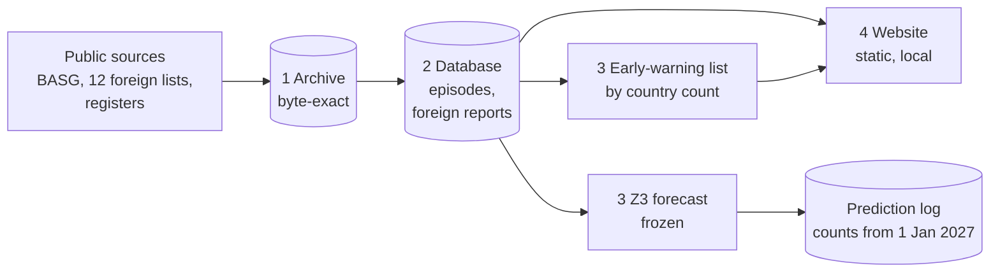
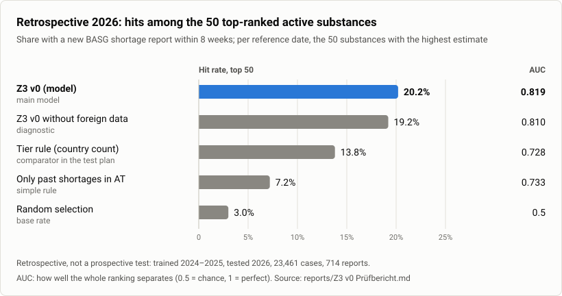
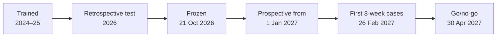

# Lieferengpass-Radar

[](https://doi.org/10.5281/zenodo.24168686)

**An early-warning tool for medicine shortages in Austria: a Python command-line tool for Linux that archives public shortage registers every day and turns them into shortage histories, an early-warning list and a static website.**

The website is meant for pharmacies, hospital pharmacies, physicians and public-health staff; it is not online yet, so you build it yourself. *Lieferengpass* is German for "supply shortage". Austria's official shortage register, published by the Federal Office for Safety in Health Care (BASG), shows only today's state:

- Ended reports disappear, so you cannot see whether, or for how long, a product was short before.
- You cannot see how often an announced delivery date has already been pushed back.
- Finding out whether the same active substance is already short in Italy or Czechia means reading a dozen foreign lists in several languages.

**What the radar does differently:**

- **It keeps everything.** Every day it downloads the BASG register and 12 shortage lists from other authorities (the EU's EMA and 11 countries) and stores unaltered copies, each with a SHA-256 checksum that makes any change detectable and an audit-trail entry.
- **It links.** From that archive it rebuilds the shortage history of each package (one pack size, identified by its PZN number) and puts active substances that are still available in Austria, but already reported short in at least two other countries, on an early-warning list.
- **It forecasts under a pre-registered plan.** A model estimates, per active substance, the chance of a new BASG report within 8 weeks. Trained on 2024–2025 and tested on 2026 (23,461 cases, 714 new reports), it ranked substances better than simply counting reporting countries (AUC 0.819 vs 0.728; 0.5 is chance, 1 is perfect). Model and test plan were frozen on 21 Oct 2026 and are published here with checksums; the prospective test starts on 1 Jan 2027.

The project uses public data only — no data from pharmacies, wholesalers or patients.

[Quick start](#quick-start) · [How it works](#how-it-works) · [Does the forecast work?](#does-the-forecast-work) · [Pre-registration](#pre-registration) · [Documentation (German)](documentation/README.md) · [Deutsch](README.de.md)

```bash
# Linux, Python ≥ 3.12, inside the cloned repository. A fresh clone holds no data;
# histories and early warnings build up from daily runs of all sources.
python3 -m venv .venv && .venv/bin/pip install -e . && source .venv/bin/activate
stockout fetch --source basg      # download today's BASG register only (about 1.1 MB)
stockout build && stockout site   # rebuild the database from the archive, then write the HTML pages
xdg-open site/index.html          # example from 10 Nov 2026: "Lage am 10.11.2026" (situation on …),
                                  #   844 packages listed, 612 unavailable or restricted, the rest marked available
```

## Example: what the official register does not show


*Built on 10 Nov 2026 by the reference instance: the author's installation, running daily since 17 Oct 2026.*

The register shows one entry for this package: status, report date and the latest announced delivery date. The radar shows what happened before: reported since 15 Sep 2023, the delivery date postponed nine times, most recently to 31 Oct 2026, which had already passed on 10 Nov 2026. Hatching means "not observed daily": before 17 Oct 2026 the archive holds only individual snapshots.

## How it works

The radar has four parts that run one after another: **archive, link, estimate, show.**



| Part | What it does | Code (`src/stockout_at/`) · docs |
|---|---|---|
| Archive (`stockout fetch`) | stores each new file version unaltered, with checksum and log entry; registers delete ended reports, so an unarchived day is lost | `archive.py` · [DATENQUELLEN.md](documentation/DATENQUELLEN.md) |
| Database (`stockout build`) | rebuilds shortage episodes per package (start, status changes, postponed dates, end) and links foreign reports by ATC code, the international code per active substance | `build.py`, `episodes.py`, `foreign.py` · [ARCHITEKTUR.md](documentation/ARCHITEKTUR.md) |
| Early warning and Z3 | ranks substances into tiers by the number of countries reporting a shortage (A: 5 or more, B: 3–4, C: 2); the frozen Z3 model writes daily probabilities to a log | `fruehwarnung.py`, `modell.py`, `models/` · [MODELL_UND_BEWERTUNG.md](documentation/MODELL_UND_BEWERTUNG.md) |
| Website (`stockout site`) | static pages: today's situation, history per package, available equivalents, overdue dates, early-warning list | `site.py`, `web/` · [WEBSITE.md](documentation/WEBSITE.md) |

Official BASG fields appear verbatim; everything derived is labelled "Eigene Auswertung" (own analysis). The Z3 forecast stays in the log, not on the website.


*Early-warning list of the reference instance, 10 Nov 2026, including sources the public code leaves out ([differences](#differences-from-the-reference-instance)). The page states: "Keine Prognose, keine Bestellempfehlung" (not a forecast, not an ordering recommendation).*

## Quick start

**Prerequisites:** Linux (tested on Ubuntu with Python 3.12.3), Python ≥ 3.12, Git, and internet access to BASG. **Not needed:** an account, an API key, a database server or root rights. `pdftotext` (poppler) is needed only for full daily operation.

```bash
git clone https://github.com/benediktneumayer2-tech/lieferengpass-radar.git
cd lieferengpass-radar
python3 -m venv .venv
.venv/bin/pip install -e .   # editable, because the model looks for models/ next to the source tree
source .venv/bin/activate
```

**Your first result.** This output was recorded on 10 Nov 2026 on the reference instance and has not been re-run for the public version. File names and numbers change daily; the command line speaks German.

```text
$ stockout fetch --source basg
OK basg: neu, 1130304 Bytes, basg/2026/2026-11-10T02-00-15_c0ead962bf85.xml.gz

$ stockout build
Datenbank neu gebaut: data/derived/stockout.sqlite (0.2 s)
  snapshots          1
  snapshot_packages  844
  packages           844
  episodes           696
  …
  foreign_items      0
  foreign_links      0

$ stockout site
Website erzeugt: site (1133 Seiten: liste 4, packung 844, start 1, text 3, wirkstoff 281; 0.3 s)
```

Open `site/index.html` to see the start page from the first screen; on 10 Nov 2026 it also listed 57 overdue delivery dates. If search does not work from the file, run `stockout preview --port 8000` (127.0.0.1 only).

- **Not there yet:** one file gives no history and an empty early-warning list; both need many daily files and the foreign lists (`stockout daily`).
- **Where it writes:** `data/` and `site/` in the current folder, both outside Git. Clean up with `rm -rf data site`.
- **Daily operation and tests:** [installation and timers](documentation/BETRIEB.md#installation), [tests](documentation/ENTWICKLUNG.md#tests).

## Does the forecast work?

<picture>
  <source media="(prefers-color-scheme: dark)" srcset="documentation/assets/z3-retrospective-dark.svg">
  
</picture>

Z3 is a regularised logistic regression in plain Python. In the 2026 test (BASG data up to 20 Oct 2026, 8-week horizon; a case is one active substance on one reference date, every 14 days), 20.2% of the 50 substances with the highest estimate per reference date received a report, against 13.8% for the tier rule. Intervals and calibration: [Z3 v0 test report](reports/Z3%20v0%20Pr%C3%BCfbericht.md) (German).

- **This is retrospective, not prospective.** Before 17 Oct 2026 there are only 28 individual BASG snapshots, many foreign lists delete ended reports, and cases of the same substance are not independent.
- **Foreign data add little in hindsight.** Without them the same model reaches AUC 0.810. Most of its power comes from the number of marketed products and past shortages; foreign reports mainly lift the top of the list.

## Pre-registration

The five forecasting methods and the test plan were frozen on 21 Oct 2026 and are published in `models/`. The plan, `pruefplan.json`, fixes start date, reference dates, outcome and main comparison, and each model file by its SHA-256; `SHA256SUMS` covers all files. The test passes if, after 8 weeks, Z3 has a lower Brier score (mean squared error of the probabilities) and a higher top-50 hit rate than the tier rule. Every row of the daily prediction log carries the plan hash `35a230a0a9bd`, and the evaluation counts only those rows.



From 1 Jan 2027 only what the daily log recorded on the reference dates counts; a missed day cannot be made up. The go/no-go on 30 Apr 2027 is the first report under the plan. **The results will be published either way, including a no-go.** The frozen state is archived on Zenodo as release `v0.1-prereg`: [doi:10.5281/zenodo.24168687](https://doi.org/10.5281/zenodo.24168687). How to recompute the hashes, including a quirk in three model files: [Vorab-Registrierung](documentation/MODELL_UND_BEWERTUNG.md#12-vorab-registrierung).

## Data integrity

The archive is designed along the ALCOA+ data-integrity principles used in GxP quality work:

| Principle | Implementation |
|---|---|
| Original, enduring | Each file version is stored unaltered (gzip), re-read and checked against the SHA-256 of the original bytes, then renamed atomically; an optional second copy is compared by checksum. |
| Attributable, contemporaneous, complete | One append-only manifest line per fetch attempt, failed ones included: source, URL, time, HTTP status, checksum. |
| Consistent | The database is rebuilt deterministically from the archive. |
| Accurate | Official fields are shown verbatim with source and date; own analyses are labelled. |

These are design choices, not a validation: the radar is not a validated computerised system in the GxP sense.

## Status and limits

| Part | Status on 10 Nov 2026 |
|---|---|
| Daily archive | running on the reference instance since 17 Oct 2026; no BASG day missing |
| Episodes | history back to 10 Apr 2021 from 28 snapshots, 10 of them truncated |
| Z3 forecast | frozen, logged daily; prospectively untested |
| Website | built locally, not yet public |
| Planned | forecasts of whether a delivery date holds and when a shortage ends; open data exports; public website |

**What it is not:** not a service of BASG or any other authority, and no view of stock levels. It runs on one machine without notifications, and linking foreign reports by ATC code is coarse. All known limits: [ENTWICKLUNG.md](documentation/ENTWICKLUNG.md#bekannte-grenzen-und-technische-schulden).

**Health notice:** The radar gives no medical, therapy, substitution or ordering advice and says nothing about individual patients. The BASG register is authoritative; forecasts are estimates with uncertainty. Provided free of charge and without warranty.

## Differences from the reference instance

The reference instance produced the frozen models, the prediction log and the screenshots; the prospective test scores its log. It archives a few additional sources whose use is still being clarified with their operators, so the public code leaves them out. Models and test plan are byte-identical (`models/SHA256SUMS`), but country counts and early-warning tiers differ, and one register hint is missing. Details: [Unterschiede zur Referenzinstanz](documentation/DATENQUELLEN.md#4-unterschiede-zur-referenzinstanz).

## Privacy and security

- **Outgoing:** only requests for public files, with the user agent `LieferengpassRadar/0.1 (+https://github.com/benediktneumayer2-tech/lieferengpass-radar)`; a contact only if you set `STOCKOUT_CONTACT`. No telemetry.
- **Never publish your `data/` folder:** the archive holds raw data from the German BfArM, which may not be republished without consent, and the database keeps the BASG phone column. It is in `.gitignore`.
- **The website** hides phone numbers and BfArM reports, sets no cookies and loads nothing from third parties; tests check all three ([WEBSITE.md](documentation/WEBSITE.md#regeln-der-darstellung-umgesetzt)). No port is open except during `stockout preview`, on 127.0.0.1.

## How it was built

The radar was developed with AI coding agents (Claude Code). The author contributed the domain knowledge and the specification — which sources to use, when a shortage episode starts and ends, the test plan and the decision to freeze it, the stated limits — and validated the results; the agents wrote most of the code. Commits made with an agent carry a `Co-Authored-By` trailer.

## Documentation

The detailed documentation is in German: [overview](documentation/PROJECT_OVERVIEW.md) · [architecture](documentation/ARCHITEKTUR.md) · [data sources](documentation/DATENQUELLEN.md) · [model and evaluation](documentation/MODELL_UND_BEWERTUNG.md) · [operation](documentation/BETRIEB.md) · [website](documentation/WEBSITE.md) · [development and tests](documentation/ENTWICKLUNG.md) · [Z3 v0 test report](reports/Z3%20v0%20Pr%C3%BCfbericht.md). Start with the [documentation index](documentation/README.md).

## Licence and contact

- **Licence:** code under Apache-2.0 ([LICENSE](LICENSE)); own texts and derived data (analyses) under CC BY 4.0; data from the sources under each source's own terms ([DATENQUELLEN.md](documentation/DATENQUELLEN.md)).
- **Names:** the package `stockout_at`, the command `stockout` and the working title "Stockout Forecaster AT" in the systemd descriptions date from the working phase; the website is titled "Lieferengpass-Radar".
- **Contact:** [GitHub issues](https://github.com/benediktneumayer2-tech/lieferengpass-radar/issues).
