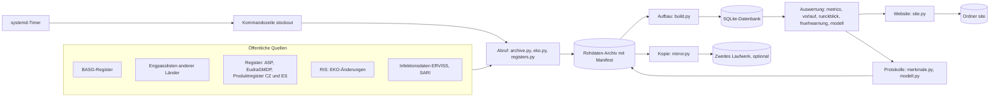
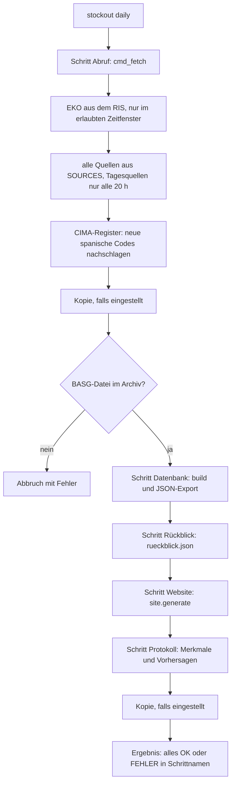
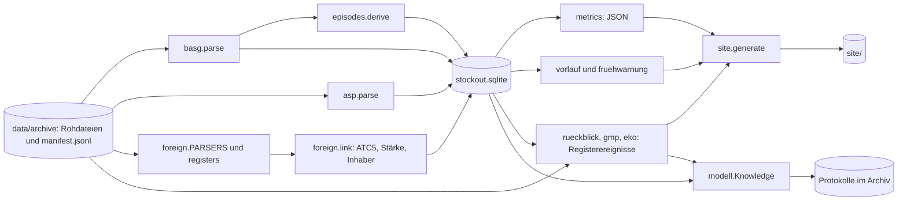

# Architektur

**Stand:** 11.11.2026 · öffentliche Fassung 0.1 · Übersicht: [PROJECT_OVERVIEW.md](PROJECT_OVERVIEW.md)

Dieses Dokument beschreibt, wie das System heute gebaut ist: Komponenten, Module, Kontroll- und Datenfluss und die Speicherorte. Quellen im Einzelnen stehen in [DATENQUELLEN.md](DATENQUELLEN.md), die Auswertungen in [MODELL_UND_BEWERTUNG.md](MODELL_UND_BEWERTUNG.md), Befehle und Zeitsteuerung in [BETRIEB.md](BETRIEB.md).

## 1. Grundform

Das Projekt ist **ein Python-Paket (`stockout_at`) mit einer Kommandozeile (`stockout`)**. Es gibt keinen Server, keine Datenbank-Instanz und keinen offenen Port. Nur `stockout preview` startet auf Wunsch einen lokalen Webserver auf `127.0.0.1` (siehe [BETRIEB.md](BETRIEB.md#preview)). Drei systemd-Benutzer-Timer rufen die Kommandozeile auf.

Die Verarbeitung ist eine Kette mit klaren Übergaben:

1. **Abruf** (`fetch`): öffentliche Dateien holen, prüfen und byte-genau ins Rohdaten-Archiv legen.
2. **Aufbau** (`build`): aus dem Archiv eine SQLite-Datenbank neu bauen (Schnappschüsse, Episoden, Auslandsmeldungen, ASP-Liste).
3. **Auswertung**: Kennzahlen als JSON, Rückblicktests, Frühwarnstufen, Z3-Vorhersagen.
4. **Website** (`site`): statische HTML-Seiten aus der Datenbank.
5. **Protokoll** (`protokoll`): tägliches Merkmals- und Vorhersageprotokoll ins Archiv.
6. **Kopie** (`mirror`, optional): fehlende Archivdateien auf ein zweites Laufwerk; aus, solange `STOCKOUT_MIRROR` leer ist.

`stockout daily` führt die Schritte 1 bis 6 nacheinander aus (Abschnitt 4).

### Leitprinzipien (umgesetzt)

| Prinzip | Umsetzung im Code |
|---|---|
| Rohdaten sind die Wahrheit | `archive.Archive.store` speichert jede neue Fassung gzip-komprimiert, prüft sie nach dem Schreiben durch Zurücklesen (SHA-256 der Originalbytes) und benennt sie erst dann atomar um. Eine bereits bekannte Prüfsumme wird nur im Manifest vermerkt (`duplicate: true`). |
| Lückenloser Nachweis | Jeder Abrufversuch, auch ein fehlgeschlagener, wird als JSON-Zeile an `manifest.jsonl` angehängt (`Archive.append`, mit `fsync`). Eine abgerissene letzte Zeile wird beim Lesen übersprungen. |
| Datenbank ist Wegwerfware | `build.build` erzeugt die Datenbank deterministisch aus dem Archiv in eine Temporärdatei und ersetzt die alte mit `os.replace`. Es werden keine Uhrzeiten des Laufs gespeichert. |
| Fehler bleiben lokal | `archive.fetch_all` ruft jede Quelle unabhängig ab. EKO und das CIMA-Register laufen in eigenem `try/except` (`cli.cmd_fetch`). Beim Aufbau wird eine unlesbare Auslandsdatei übersprungen (`foreign.load`). `stockout daily` versucht jeden Schritt, auch wenn ein früherer scheiterte. |
| Atomare Ausgaben | Website: Aufbau in ein Temporärverzeichnis, dann Austausch (`site.generate`). Protokolle: `.tmp` und `os.replace` (`merkmale.write`, `modell.write_log`). |
| Wenige Abhängigkeiten | Abruf nur mit der Standardbibliothek (`urllib`). Laufzeitabhängigkeiten laut `pyproject.toml`: `jinja2` (Website) und `xlrd` (alte `.xls`-Dateien von ANSM und EudraGMDP). Für die polnische PDF-Liste wird das Systemprogramm `pdftotext` (poppler) aufgerufen (`foreign.pdf_blocks`). |
| Amtlich und eigen getrennt | BASG-Felder gehen wörtlich in die Datenbank und auf die Website; abgeleitete Werte tragen auf der Website die Kennzeichnung „eigene Auswertung“ (siehe [WEBSITE.md](WEBSITE.md)). |

## 2. Komponenten



## 3. Modulkarte (`src/stockout_at/`)

| Modul | Aufgabe | Wichtige Symbole |
|---|---|---|
| `cli.py` | Kommandozeile (argparse), Ablauf der Befehle, Alarmregel beim Abruf | `main`, `cmd_fetch`, `cmd_daily`, `cmd_status`, `cmd_bewertung`, `cmd_protokoll`, `cmd_preview` |
| `archive.py` | Quellenliste, Abruf mit Wiederholung und Formatprüfung, Archiv und Manifest | `SOURCES`, `Source`, `Archive`, `fetch_source`, `fetch_all`, `retry_due`, `last_success`, `_check`, `user_agent` |
| `eko.py` | EKO-Änderungen aus dem RIS: Zeitfenster, Abruf, HTML-Parser | `allowed`, `sync`, `parse`, `night_end` |
| `registers.py` | Produktregister CZ und ES (dazu ein Parser für archivierte finnische Registerdateien): füllen fehlende ATC-Codes und Inhaber der Auslandsmeldungen | `parse_sukl_dlp`, `parse_fimea_reg`, `parse_cima_reg`, `sync_cima`, `load`, `fill` |
| `legacy.py` | Einmalige Importe der Vorgeschichte (lokal gesicherte Dateien, TermGit-ASP, Internet Archive, polnische Ausgaben seit 2015) | `import_basg_package`, `import_asp_package`, `import_wayback`, `import_pl_mz`, `DEFAULT_PACKAGE` |
| `mirror.py` | Zweite Kopie des Archivs (optional), Prüfsummenvergleich | `mirror`, `missing_files`, `verify`, `STATE` |
| `status.py` | Gesundheit des Archivs: letzter Erfolg je Quelle, fehlende BASG-Tage, Kopie | `collect`, `render`, `missing_basg_days`, `STALE_HOURS = 36`, `VIENNA` |
| `basg.py` | Toleranter Parser der BASG-XML in Schnappschusszeilen (alle amtlichen Felder wörtlich) | `parse`, `Snapshot`, `FIELDS`, `package_key` |
| `asp.py` | ASP-Liste (TermGit-SVS-XML und ELGA-FHIR-JSON) | `parse`, `parse_fhir`, `concept_row`, `fhir_date` |
| `substances.py` | Konservative Wirkstoff-Normalisierung, ATC-Gruppen | `normalise`, `base_substance`, `split_components`, `atc_groups` |
| `episodes.py` | Engpass-Episoden je Packung aus der Schnappschussfolge | `derive`, `Episode`, `SnapshotView`, `END_STATUSES` |
| `foreign.py` | Parser der Auslandslisten, Zusammenführen über Dateien, ATC-Ableitung, Verknüpfung mit AT-Packungen | `PARSERS`, `COUNTRY`, `load`, `aggregate`, `listings`, `link`, `derive_atc`, `holder_key`, `GROUPS`, `read_xlsx`, `read_xls`, `pdf_blocks` |
| `gmp.py` | GMP-Signale je Wirkstoff: EudraGMDP-Berichte, dazu archivierte CEP-Dateien der EDQM, falls vorhanden | `parse_cep`, `parse_ncr`, `load` |
| `build.py` | Schema und vollständiger Neuaufbau der Datenbank | `SCHEMA`, `build`, `load_snapshots`, `load_asp`, `_unique_files` |
| `metrics.py` | Kennzahlen für Website und JSON-Export (Lage, überfällig, Woche, Dauern, Wirkstoffe) | `collect`, `export_json`, `overdue`, `RESTRICTED` |
| `vorlauf.py` | Vorlaufmessung und Hinweisstufen A/B/C | `measure`, `tier`, `Intervals`, `HORIZONS` |
| `schaerfe.py` | Messung möglicher Schärfungen der Stufen; enthält auch Rechenhilfen für `modell` | `measure`, `logit`, `auc`, `top_rate`, `_bootstrap`, `_solve` |
| `rueckblick.py` | Rückblicktests weiterer Signale (T1, T2, T4, T6–T9) | `measure`, `AspHistory`, `mia_events`, `asp_exits`, `eko_events` |
| `fruehwarnung.py` | Frühwarnliste und Registerhinweise für die Website | `build`, `current_items`, `substance_tier`, `register_hints` |
| `merkmale.py` | Tägliches Merkmalsprotokoll je Produkt; ruft die Z3-Vorhersagen auf | `run`, `rows`, `write`, `COLUMNS` |
| `modell.py` | Z3-Verfahren: Merkmale, Lernen, Prüfen, Einfrieren, Vorhersageprotokoll, Bewertung | `Knowledge`, `METHODS`, `measure`, `freeze`, `load_plan`, `predict_all`, `write_log`, `read_logs`, `bewerten`, `simulate` |
| `timeline.py` | Zeitleisten als SVG und als Text | `timeline_svg`, `mini_svg`, `events` |
| `site.py` | Statischer Website-Generator (Jinja2) | `generate`, `Data`, `SITE_TITLE`, `HIDDEN_FIELDS`, `HIDDEN_SOURCES`, `FOREIGN_SOURCES` |
| `web/templates/*.html`, `web/assets/` | Seitenvorlagen, Stylesheet `style.css`, Suche `search.js` | – |

## 4. Kontrollfluss des Tageslaufs (`stockout daily`)

`cli.cmd_daily` ruft nacheinander fünf Schritte auf. Jeder Schritt läuft in einem eigenen `try/except`; ein Fehler wird gemeldet, der nächste Schritt läuft trotzdem. Nur wenn das Archiv gar keine BASG-Datei enthält, bricht der Lauf vor dem Aufbau ab.



Einzelheiten:

- **Abruf** (`cmd_fetch` ohne `--source`): Zuerst EKO (`eko.sync`, nur 20–5 Uhr Wiener Zeit oder am Wochenende), dann `fetch_all` über alle 19 Quellen in `SOURCES`; Quellen mit `min_hours` (Tagesquellen) werden übersprungen, solange ihr letzter erfolgreicher Abruf jünger als 20 Stunden ist. Danach `registers.sync_cima` und, falls eingestellt, die Kopie. Die Alarmregel (FEHLER oder WARNUNG) steht in [BETRIEB.md](BETRIEB.md#meldungen-alarme-und-status).
- **Datenbank**: `build.build`, dann `metrics.export_json` nach `data/derived/json/`.
- **Rückblick**: `rueckblick.run` schreibt `data/derived/json/rueckblick.json`. Die Website liest daraus die Trefferquoten der Registerhinweise.
- **Website**: `site.generate` (siehe [WEBSITE.md](WEBSITE.md)).
- **Protokoll**: `merkmale.run` schreibt das Merkmalsprotokoll und, wenn ein Prüfplan eingefroren ist, über `modell.write_log` das Vorhersageprotokoll; danach noch einmal die Kopie, falls eingestellt.
- Der Lauf endet mit Exit-Code 1, wenn ein Schritt scheiterte, sonst 0.

## 5. Datenfluss



Die Datenbank enthält nur, was sich aus dem Archiv ableiten lässt. Registerereignisse (EKO-Streichungen, ASP-Fassungen, GMP-Berichte; in der Referenzinstanz auch MIA-Verlautbarungen und CEP-Datei) werden nicht in die Datenbank geschrieben, sondern von `rueckblick`, `gmp`, `fruehwarnung`, `merkmale` und `modell` bei Bedarf direkt aus dem Archiv gelesen (`rueckblick._latest`, `rueckblick.AspHistory.load`, `rueckblick.eko_events`).

## 6. Speicherorte

Standardpfade sind relativ zum Arbeitsverzeichnis (die systemd-Units setzen es auf den Projektordner); Optionen und Umgebungsvariablen stehen in [BETRIEB.md](BETRIEB.md#konfiguration).

```text
data/                                  nicht in Git (.gitignore)
  archive/                             Rohdaten-Archiv (--archive, STOCKOUT_ARCHIVE)
    manifest.jsonl                     eine JSON-Zeile je Abrufversuch bzw. Fassung (nur anhängen)
    mirror_state.json                  letzter Versuch, letzter Erfolg, letzter Fehler der Kopie
    <quelle>/<JJJJ>/<stempel>_<sha12>.<endung>.gz
    protokoll/merkmale/<JJJJ>/<JJJJ-MM-TT>.csv.gz      Merkmalsprotokoll (seit 19.10.2026)
    protokoll/vorhersagen/<JJJJ>/<JJJJ-MM-TT>.csv.gz   Vorhersageprotokoll (seit 21.10.2026)
  derived/
    stockout.sqlite                    abgeleitete Datenbank (--db, STOCKOUT_DB)
    json/                              situation, overdue, week, durations, substances, rueckblick (.json)
    vorhersagen_rueckblick/            Probelauf 2026 von "stockout bewertung --rueckblick"
site/                                  erzeugte Website (--out, STOCKOUT_SITE), nicht in Git
models/                                eingefrorene Verfahren und Prüfplan (in Git)
$STOCKOUT_MIRROR                       optionale zweite Kopie von data/archive (--mirror-dir; leer = keine Kopie)
```

**Dateinamen im Archiv** (`Archive.store`): `<quelle>/<Jahr>/<Stempel>_<erste 12 Zeichen SHA-256>.<Endung>.gz`. Der Stempel ist

- bei BASG das `producedOn` der Datei (Doppelpunkte durch Bindestriche ersetzt),
- bei der ASP-Liste das FHIR-Datum der Fassung,
- bei EKO und den nachgeladenen polnischen Ausgaben der Veröffentlichungstag,
- bei Internet-Archive-Aufnahmen der Aufnahmezeitpunkt,
- sonst die Abrufzeit in UTC (`JJJJ-MM-TTTHHMMSSZ`).

**Manifest-Felder** (eine Zeile, JSON, Schlüssel sortiert): `recorded_at`, `source`, `origin`, `ok`, `sha256`, `bytes`, `duplicate`, `path`, `url`, `fetched_at`, `http_status`, `content_type`, `last_modified`, `etag`, `produced_on`, `warnings`, `attempts`, bei Fehlern `error`. Dazu je nach Quelle `act`/`published` (Polen), `doc`/`title`/`published`/`captured_at` (EKO), `codes` (CIMA-Register) und bei Importen `captured_at`, `evidence_urls`, `imported_from`.

Werte von `origin` im Archiv der Referenzinstanz: `live` (Tageslauf), `wayback` (Internet Archive), `legacy_local` (lokal gesicherte BASG-Datei), `termgit_history` (ASP-Historie), `backfill` (Polen seit 2015, EKO seit 2004) und `einzelabruf` (zwei EKO-Einträge vom 19.10.2026; kein heutiger Codepfad erzeugt diesen Wert).

**Umfang am 10.11.2026** (beobachtet in der Referenzinstanz): 1.321 `.gz`-Dateien mit 600,1 MB laut `stockout status` (`du -sh data/archive`: 577 MB), Datenbank 107 MB, Website 149 MB mit 5.558 Seiten.

## 7. Abgeleitete Datenbank

Schema: `build.SCHEMA`. Zeilenzahlen aus dem Aufbau des Tageslaufs der Referenzinstanz vom 10.11.2026, 06:29 Uhr.

| Tabelle | Inhalt | Zeilen |
|---|---|---:|
| `meta` | Stand: letzter Schnappschuss, Zahl der BASG-Dateien, verwendete ASP-Fassung (`asp_path`, `asp_version`), Endstatus, Packungen ohne Episode | 6 |
| `snapshots` | eine Zeile je BASG-Fassung (`snapshot_id` = `producedOn`), Herkunft, `complete` (0 = abgeschnittene Aufnahme) | 53 |
| `snapshot_packages` | je Schnappschuss und Packung alle amtlichen Felder wörtlich, unbekannte Elemente in `extra` | 44.055 |
| `packages` | je Packung: PZN, Zulassungsnummer, Name, normalisierter Wirkstoff, ATC 5/3, erstes/letztes Sehen, Zahl der Episoden, in der ASP-Liste | 4.680 |
| `episodes` | Engpass-Episoden je Packung (Beginn und Quelle des Beginns, Ende als Intervall, Endgrund, Verschiebungen, `history_quality`) | 5.503 |
| `episode_status`, `episode_resupply` | Statusfolge und Folge der angekündigten Termine je Episode | 6.027 / 4.755 |
| `substance_map` | Wirkstoffbestandteil → Grundstoff | 984 |
| `asp_packages` | neueste ASP-Fassung: alle Packungen mit `lieferbar`, Inhaber, ATC, Wirkstoffen, Form, `equiv_key` | 21.339 |
| `foreign_items` | Auslandsmeldungen, je Meldung und Produkt über alle Dateien zusammengeführt | 85.709 |
| `foreign_links` | Auslandsmeldung ↔ österreichische Packung gleichen ATC 5, mit `strength_match`, `holder_match` | 322.564 |

Von den 53 Schnappschüssen stammen 25 aus dem Tagesarchiv (lückenlos seit 17.10.2026), 27 aus dem Internet Archive und einer aus einem lokal gesicherten BASG-Export vom 18.07.2026; 10 sind abgeschnittene Aufnahmen. Der älteste ist vom 10.04.2021.

**Datenschutz:** `snapshot_packages` übernimmt alle BASG-Felder wörtlich, auch `Zulassungsinhaber_Tel`. Die Website blendet dieses Feld aus (`site.HIDDEN_FIELDS`), die Datenbank aber nicht. Das Archiv enthält außerdem die BfArM-Rohdaten. `data/` ist deshalb nicht zur Veröffentlichung bestimmt.

## 8. Fehlergrenzen

| Stelle | Verhalten |
|---|---|
| Netzwerk- oder HTTP-Fehler einer Quelle | bis zu drei Versuche (Pausen 15 s und 60 s, `RETRY_DELAYS`), danach Manifest-Eintrag mit `ok: false`; andere Quellen laufen weiter |
| Antwort besteht die Formatprüfung nicht (z. B. Wartungsseite) | wird wie ein Netzfehler wiederholt; die letzte Antwort wird zur Diagnose aufbewahrt, aber mit `ok: false` vermerkt und nie in die Datenbank übernommen |
| RIS-Fehler (EKO) | eigene Wiederholung nach 60 s und 300 s (±20 % Zufall), dann Eintrag mit `ok: false` |
| BASG-XML defekt oder abgeschnitten | `basg.parse` wirft nie; vollständige `Packung`-Elemente vor dem Abbruch werden übernommen, `complete = 0`, `parse_error` gefüllt; abgeschnittene Schnappschüsse belegen nie das Fehlen einer Packung |
| Parserfehler einer Auslands- oder Registerdatei | Datei wird beim Aufbau übersprungen, **ohne Meldung** (`foreign.load`, `registers.load`) |
| Kopie eingestellt, aber Laufwerk nicht eingehängt (`STOCKOUT_MIRROR_MOUNT`) | `FEHLER Kopie`, Exit-Code 1; der nächste Lauf kopiert alles Fehlende nach |
| Schritt im Tageslauf scheitert | Meldung `FEHLER <Schritt>`, die folgenden Schritte laufen trotzdem |
