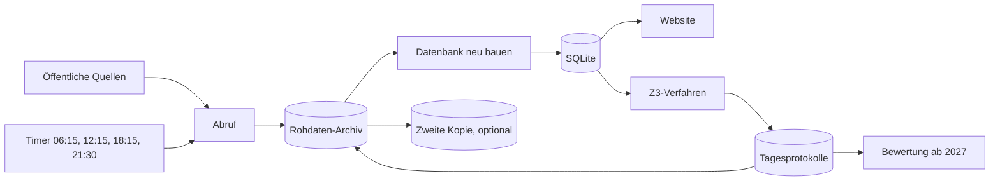
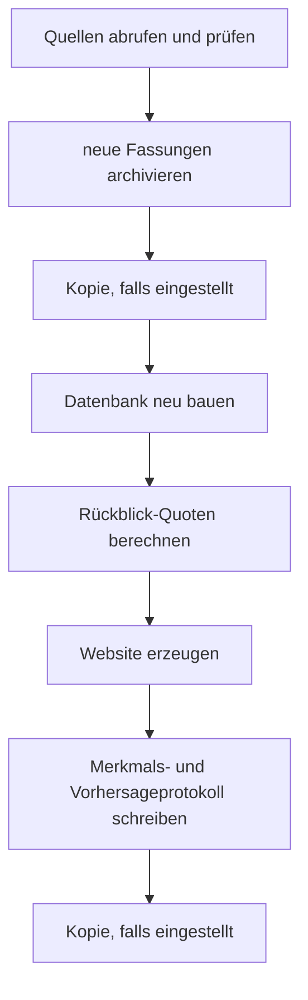
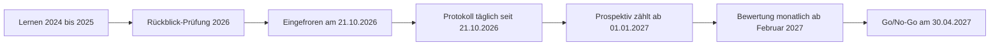

# Projektüberblick: Lieferengpass-Radar

**Stand:** 11.11.2026 · öffentliche Fassung 0.1 · Python-Paket `stockout_at`, Kommandozeile `stockout` (Namen: [README.md](README.md#namen))

## Worum es geht

Österreich veröffentlicht täglich ein amtliches Register der Arzneimittel-Vertriebseinschränkungen (BASG). Es zeigt nur den heutigen Stand: Beendete Meldungen verschwinden, es gibt keinen Verlauf, keine Sicht auf den Wirkstoff und keine Einschätzung, was als Nächstes knapp wird.

Das Projekt schließt diese Lücken nur mit öffentlichen Daten:

| Funktion | Warum |
|---|---|
| **Tägliches Rohdaten-Archiv** von BASG und 20 weiteren Quellen und Registern | Jeder Tag ohne Archiv ist verloren, weil die meisten Register beendete Meldungen löschen. Rohdaten werden byte-genau gesichert, bevor irgendetwas ausgewertet wird. |
| **Engpass-Episoden** je Packung mit Beginn, Statusfolge, Terminverschiebungen und Ende | macht aus Tagesständen einen nachvollziehbaren Verlauf; Vorgeschichte aus Einzelaufnahmen ist als lückenhaft markiert |
| **Frühwarnung aus dem Ausland**: Wirkstoffe, die in AT lieferbar und nicht gemeldet sind, aber in anderen Ländern als Engpass gemeldet werden | Viele Engpässe treffen mehrere Länder zeitversetzt; die Zahl der meldenden Länder ist im Rückblick das stärkste Auslandssignal |
| **Hinweise aus österreichischen Registern** (Änderung beim Zulassungsinhaber, anderer Inhaber gemeldet) | im Rückblick etwa 2× bzw. 1,7× häufiger gefolgt von einer BASG-Meldung; der erste Hinweis braucht eine Quelle, die nur die Referenzinstanz abruft ([Unterschiede](DATENQUELLEN.md#4-unterschiede-zur-referenzinstanz)) |
| **Z3-Schätzung**: Wahrscheinlichkeit einer neuen BASG-Meldung je Wirkstoff binnen 4, 8, 12 Wochen, fünf eingefrorene Verfahren | eine ehrliche, vorab festgelegte Prüfung statt nachträglich angepasster Zahlen |
| **Statische Website** mit Lage, Suche, Packungs- und Wirkstoffseiten, Überfällig, Woche, Frühwarnliste, Methodik | für Fachleute (Apotheken, Ärzt:innen, Spitalapotheken, Forschung, Journalismus, Verwaltung); amtlich und eigen getrennt, ohne Tracking |

Die Website wird lokal gebaut und ist noch nicht öffentlich bereitgestellt.

## Wie die Teile zusammenspielen

Einzelheiten: [ARCHITEKTUR.md](ARCHITEKTUR.md), Quellen: [DATENQUELLEN.md](DATENQUELLEN.md).

## Abläufe

**Automatisch, zweimal täglich** (`stockout daily` um 06:15 und 18:15 Uhr):

Dazu ein Nachholabruf um 12:15 Uhr für gescheiterte Quellen und werktags um 21:30 Uhr der EKO-Abruf aus dem RIS, das nur abends und am Wochenende abgefragt werden soll. Ein Fehler einer Auslandsquelle gilt erst nach 36 Stunden ohne Erfolg als FEHLER, bei BASG sofort. Befehle und Timer: [BETRIEB.md](BETRIEB.md).

**Im Betrieb:** `stockout status` (Lücken, letzter Erfolg je Quelle), Journal der Services ansehen, bei Formatwechsel einer Quelle den Parser anpassen ([Vorgehen](BETRIEB.md#wenn-eine-quelle-format-oder-adresse-ändert)), ab Februar 2027 monatlich `stockout bewertung`.

**Entwicklung:** kleine, getestete Schritte; Tests mit `.venv/bin/python -m pytest -q` ([ENTWICKLUNG.md](ENTWICKLUNG.md)).

## Prüfung der Schätzungen

Hauptvergleich laut Prüfplan: `z3_v0` gegen die Stufenregel `stufen_v0` nach 8 Wochen; bestanden, wenn Brier-Score niedriger und Trefferquote der 50 höchsten Wirkstoffe je Stichtag höher sind. Modelle und Prüfplan liegen mit Prüfsummen in `models/` ([Vorab-Registrierung](MODELL_UND_BEWERTUNG.md#12-vorab-registrierung)). Details: [MODELL_UND_BEWERTUNG.md](MODELL_UND_BEWERTUNG.md).

## Stand

| Bereich | Stand |
|---|---|
| Tagesarchiv | **läuft** in der Referenzinstanz seit 17.10.2026; BASG lückenlos (beobachtet 10.11.2026); 1.321 Dateien, 600 MB |
| Quellen | **umgesetzt**: BASG, 12 Auslandslisten (DE nur intern, EU, IT, CZ, SK, HU, SI, BE, ES, US, FR, PL), ASP-Liste, EudraGMDP, Produktregister CZ/ES, EKO aus dem RIS, Infektionsdaten. Die Referenzinstanz archiviert einige mehr ([Unterschiede](DATENQUELLEN.md#4-unterschiede-zur-referenzinstanz)). |
| Datenbank, Episoden, Kennzahlen | **umgesetzt**; in der Referenzinstanz 53 BASG-Schnappschüsse seit 2021, 5.503 Episoden |
| Website | **umgesetzt, nur lokal**; 5.558 Seiten in der Referenzinstanz; Impressum und Datenschutz mit Platzhaltern; noch mit Arbeitstitel |
| Frühwarnliste | **umgesetzt** als Hinweis nach Länderzahl (A 5+, B 3–4, C 2 Länder) mit bisheriger Trefferquote |
| Z3-Verfahren | **umgesetzt und eingefroren**; Vorhersagen nur im Protokoll, nicht auf der Website |
| Prospektive Prüfung | **beginnt 01.01.2027**; noch keine gültige Bewertung |
| Z1/Z2-Prognosen, E-Mail-Überblick, offene Exporte, zweiter Abruf in der Cloud, öffentliche Website | **geplant**, nicht umgesetzt |

## Wichtige Zahlen und ihre Bedingungen

- **Z3 v0 im Rückblick** (gelernt 2024–2025, geprüft 2026, 8 Wochen, 23.461 Fälle, 714 Meldungen): AUC 0,819 gegenüber 0,728 der Stufenregel; Top 50 je Stichtag 20,2 % gegenüber 13,8 %. Ohne Auslandsmerkmale erreicht das Modell AUC 0,810; das Ausland hebt vor allem die Spitze der Liste. Das ist **keine prospektive Prüfung**.
- **Frühwarnliste** (Website der Referenzinstanz vom 10.11.2026, Rückblick ab 2024): Stufe A mit 96 Wirkstoffen, bisher in 18,4 % binnen 8 Wochen eine BASG-Meldung; Vergleich ohne Auslandsblick 6,8 %.
- Ein früher, informeller Zwischenblick (Oktober/November 2026) sah `z3_v0` vor `stufen_v0`, ist aber **keine gültige Bewertung**.

## Grenzen

- Die BASG-Vorgeschichte vor dem 17.10.2026 besteht aus 28 Einzelaufnahmen (April 2021 bis Juli 2026, 10 davon abgeschnitten); kurze Engpässe dazwischen fehlen.
- Die meisten Auslandslisten löschen beendete Meldungen; die Verknüpfung mit Österreich läuft grob über ATC 5.
- Ein Rechner, keine Benachrichtigung bei Fehlern; verpasste BASG-Tage sind verloren.
- Die öffentliche Fassung ruft einige Quellen der Referenzinstanz nicht ab; Modelle und Prüfplan sind trotzdem dieselben ([Unterschiede](DATENQUELLEN.md#4-unterschiede-zur-referenzinstanz)). BfArM-Daten werden nur intern genutzt.
- Weitere Grenzen und technische Schulden: [ENTWICKLUNG.md](ENTWICKLUNG.md#bekannte-grenzen-und-technische-schulden).

## Tests

Die Tests decken Abruf mit Wiederholung und Formatprüfung, Alarmregel, Kopie, Episodenregeln, Parser der Auslandslisten, Verknüpfung, Vorlauf, Rückblick-Bausteine, das Z3-Verfahren (Merkmale nur aus der Vergangenheit, Einfrieren, Protokoll) und die Website auf echten Daten ab. Sie zeigen, dass die Rechenlogik wie beabsichtigt arbeitet; ob echte Quellen ihr Format halten und ob die Schätzungen prospektiv tragen, prüfen sie nicht. Ergebnis und Einzelheiten: [ENTWICKLUNG.md](ENTWICKLUNG.md#tests).

## Weiterlesen

[ARCHITEKTUR.md](ARCHITEKTUR.md) · [DATENQUELLEN.md](DATENQUELLEN.md) · [MODELL_UND_BEWERTUNG.md](MODELL_UND_BEWERTUNG.md) · [BETRIEB.md](BETRIEB.md) · [WEBSITE.md](WEBSITE.md) · [ENTWICKLUNG.md](ENTWICKLUNG.md)
